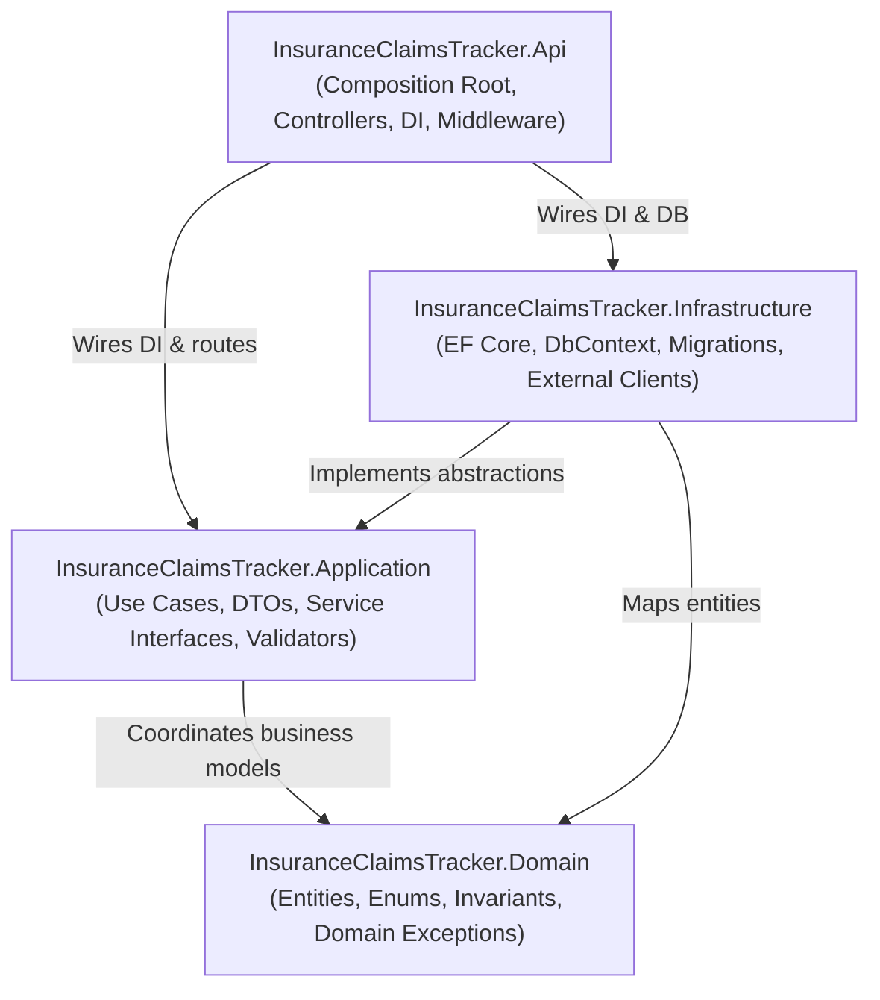
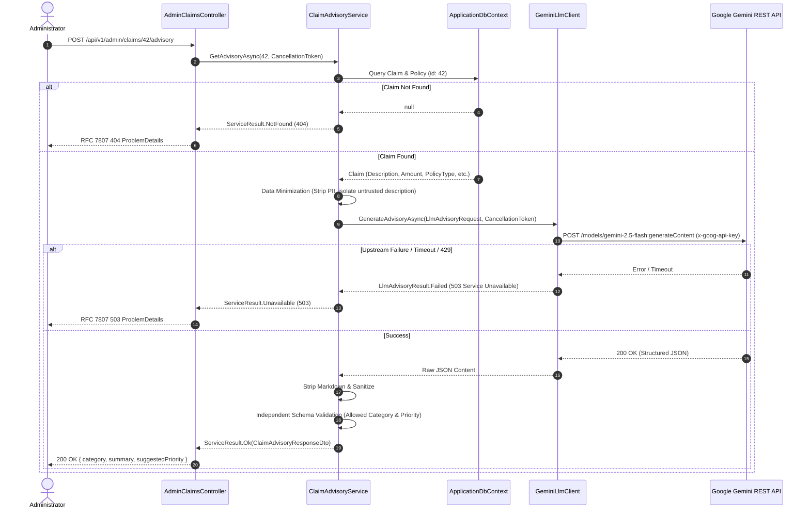

# System Architecture Overview

## 1. Architectural Style & Design Principles

The **Insurance Claims Tracker** backend follows a **Clean, Layered Architecture** (Domain-Centric / Onion hybrid), designed to adhere strictly to **SOLID** principles without introducing unnecessary indirection or framework bloat.

### Key Principles
1. **Separation of Concerns (SoC)**: Business logic is decoupled from transport layers (HTTP/API) and data access layers (EF Core/SQL Server).
2. **Dependency Inversion Principle (DIP)**: Core business abstractions do not depend on external libraries, frameworks, or database providers. Outer layers depend on inner abstractions.
3. **Pragmatic Portfolio Design**: We deliberately avoid over-engineering patterns such as full CQRS with MediatR, event sourcing, or microservices. For this application's scale, straightforward service-based application orchestration ensures that code is easy to debug, performant, readable, and defensible in technical interviews.
4. **Incremental Feature Slices**: The API project is established as the composition root at the very beginning (Phase 1) with basic middleware, health checks, OpenAPI/Swagger, and DI wiring. Endpoints and services are added incrementally across phases rather than deferring the web API until late in the project.

---

## 2. Project Structure & Dependency Directions

The solution is structured into four core application projects and two test projects:

```text
InsuranceClaimsTracker/
│
├── src/
│   ├── InsuranceClaimsTracker.Domain/          # Enterprise Business Rules & Entities
│   ├── InsuranceClaimsTracker.Application/     # Application Use Cases, DTOs & Contracts
│   ├── InsuranceClaimsTracker.Infrastructure/  # EF Core, Database Migrations & External APIs
│   └── InsuranceClaimsTracker.Api/             # Composition Root, ASP.NET Core Web API, Controllers
│
├── tests/
│   ├── InsuranceClaimsTracker.UnitTests/       # Domain Logic & Application Service Unit Tests
│   └── InsuranceClaimsTracker.IntegrationTests/# WebApplicationFactory, Integration & Concurrency Tests
│
├── frontend/                                   # React + TypeScript + Vite + Tailwind CSS
│
└── docs/                                       # Project Documentation & Architecture Plans
```

### Explicit Dependency Direction Rules

1. **`InsuranceClaimsTracker.Domain`**:
   - **Dependencies**: **None**.
   - Contains pure C# types: entities, value objects, domain enums, domain exceptions, and entity invariants.
   - Has zero references to EF Core, ASP.NET Core, or other application projects.
2. **`InsuranceClaimsTracker.Application`**:
   - **Dependencies**: Depends **only on `Domain`**.
   - Contains use case services, DTOs, interfaces (`IApplicationDbContext`, `IJwtTokenGenerator`, `IPasswordHasher`, `IClaimAiAdvisoryService`), and FluentValidation validators.
3. **`InsuranceClaimsTracker.Infrastructure`**:
   - **Dependencies**: Implements **`Application`** abstractions and uses **`Domain`**.
   - Contains EF Core `ApplicationDbContext`, entity configurations, migrations, password hasher implementation (PBKDF2), JWT token generator, and LLM external API client.
4. **`InsuranceClaimsTracker.Api`**:
   - **Dependencies**: Acts as the **Composition Root**; references **`Application`** and **`Infrastructure`**.
   - Registers dependency injection containers, configures middleware pipeline, hosts ASP.NET Core controllers, configures authentication handlers, and sets up OpenAPI/Swagger.

### Dependency Flow Diagram



---

## 3. Project Responsibilities Breakdown

### `InsuranceClaimsTracker.Domain`
- **Purpose**: Represents the core state and invariants of the domain.
- **Dependencies**: Pure C# standard library.
- **Contents**:
  - **Entities**: `User`, `Policy`, `Claim`, `ClaimHistory`.
  - **Enums**: `UserRole` (`Customer = 1`, `Admin = 2`), `PolicyType` (`Health = 1`, `Auto = 2`, `Home = 3`, `Life = 4`), `ClaimStatus` (`Submitted = 1`, `UnderReview = 2`, `Approved = 3`, `Rejected = 4`, `Paid = 5`).
  - **Domain Exceptions**: `InvalidClaimStateException`, `PolicyExpiredException`, `CoverageExceededException`, `UnauthorizedResourceAccessException`.
  - **Domain Rules**: Validation of state transitions and claim eligibility.

### `InsuranceClaimsTracker.Application`
- **Purpose**: Orchestrates application use cases and business operations.
- **Dependencies**: `Domain`, validation libraries (`FluentValidation`).
- **Contents**:
  - **Interfaces**:
    - Data Access: `IApplicationDbContext`.
    - Identity & Security: `IJwtTokenGenerator`, `IPasswordHasher`, `ICurrentUserContext`.
    - GenAI Advisory & LLM Abstraction: `IClaimAdvisoryService`, `ILlmClient`.
  - **Services**:
    - `AuthService`: Registration (strictly locked to Customer role), credential verification, JWT issuance.
    - `PolicyService`: Policy queries with strict ownership enforcement, admin policy issuance.
    - `ClaimService`: Claim submission, eligibility verification, customer claim retrieval.
    - `ClaimReviewService`: Admin claim processing (review, approve, reject, pay), concurrency conflict handling, and append-only audit trail logging.
    - `ClaimAdvisoryService`: Triage orchestration, admin authorization validation, PII data-minimization, LLM client invocation, markdown stripping, and schema validation.
  - **DTOs**: Request and Response models (including `ClaimAdvisoryResponseDto`).
  - **Validators**: FluentValidation rules and advisory domain normalization rules (`ClaimAdvisoryConstants`).

### `InsuranceClaimsTracker.Infrastructure`
- **Purpose**: Handles all technical concerns, database interactions, and external integrations.
- **Dependencies**: `Application`, `Domain`, `Microsoft.EntityFrameworkCore.SqlServer`.
- **Contents**:
  - **Data Access**:
    - `ApplicationDbContext`: Implements `IApplicationDbContext`.
    - `Configurations/`: Entity type configurations (`IEntityTypeConfiguration<T>`) defining keys, columns, relationships, cascade rules, `RowVersion`, and check constraints.
    - `Migrations/`: Version-controlled EF Core database migrations.
  - **Security Implementations**:
    - `PasswordHasher`: PBKDF2 with HMAC-SHA512.
    - `JwtTokenGenerator`: Issues signed HS256 JWT tokens.
    - `CurrentUserContext`: Extracts `UserId` and `Role` from the HTTP request's `ClaimsPrincipal`.
  - **External Integrations**:
    - `GeminiLlmClient`: Vendor-specific REST client targeting Google Gemini API (`/models/{model}:generateContent`) with `x-goog-api-key` header authentication, linked timeout tokens, exponential backoff retries on transient errors (429/5xx), immediate failure on 401/403, and JSON schema enforcement.
    - `AiServiceSettings`: Strongly-typed configuration options for AI provider settings.

### `InsuranceClaimsTracker.Api`
- **Purpose**: Composition root and HTTP entry point.
- **Dependencies**: `Application`, `Infrastructure`.
- **Contents**:
  - **Composition & Startup**:
    - `Program.cs`: Wires up DI services from `Application` and `Infrastructure`, configures ProblemDetails services, health checks (`/health`), OpenAPI/Swagger with JWT support, and standard RFC 7807 model validation failure responses.
  - **Controllers**:
    - `AuthController`: Registration and login endpoints returning standardized ProblemDetails on failure.
    - `PoliciesController`: Policy management endpoints.
    - `ClaimsController`: Customer claim submission and query endpoints.
    - `AdminClaimsController`: Admin review, decision, payout, and AI triage endpoints.
  - **Middleware & Extensions**:
    - `ExceptionHandlingMiddleware`: Centralized pipeline exception handler mapping domain, validation, concurrency, and unexpected errors to RFC 7807 `ProblemDetails` JSON responses with correlation `traceId`.
    - `ApiResultExtensions`: Helper methods transforming `ServiceResult<T>` and `AuthResult<T>` into RFC 7807 `ProblemDetails` responses.

---

## 4. Cross-Cutting Middleware Pipeline & Exception Architecture

### 4.1 Middleware Pipeline Execution Order
The ASP.NET Core request pipeline in `InsuranceClaimsTracker.Api/Program.cs` is strictly sequenced:

1. **`ExceptionHandlingMiddleware`**: First middleware in the pipeline, ensuring any unhandled exception across downstream middleware or controllers is intercepted, logged with diagnostic metadata, and mapped to an RFC 7807 `ProblemDetails` payload without exposing sensitive internal details or stack traces.
2. **Swagger / OpenAPI (`UseSwagger`, `UseSwaggerUI`)**: Enabled during Development at `/swagger/index.html` and `/swagger/v1/swagger.json`.
3. **HTTPS Redirection (`UseHttpsRedirection`)**: Enforces secure transport.
4. **Authentication (`UseAuthentication`)**: Validates JWT bearer tokens and establishes `ClaimsPrincipal` prior to authorization checks.
5. **Authorization (`UseAuthorization`)**: Evaluates role-based policies (`Customer`, `Admin`).
6. **Health Checks (`MapHealthChecks("/health")`)**: Lightweight diagnostic endpoint returning service health status and UTC timestamp.
7. **Controllers (`MapControllers`)**: Routes incoming requests to target controllers with automatic RFC 7807 model validation.

### 4.2 Centralized Exception Mapping Matrix
| Exception Type | HTTP Status | Response Title | Client Safe Message / Behavior |
| :--- | :---: | :--- | :--- |
| `CoverageExceededException` | `400 Bad Request` | Bad Request | Domain limit violation message |
| `PolicyExpiredException` | `400 Bad Request` | Bad Request | Policy coverage window error |
| `InvalidClaimStateException` | `400 Bad Request` | Bad Request | Invalid lifecycle state transition |
| `DomainException` | `400 Bad Request` | Bad Request | Domain invariant rule violation message |
| `ValidationException` / `ArgumentException` | `400 Bad Request` | Bad Request | Input validation error |
| `KeyNotFoundException` | `404 Not Found` | Not Found | Resource not found |
| `UnauthorizedResourceAccessException` | `404 Not Found` | Not Found | Prevents resource enumeration across tenants (BOLA defense) |
| `DbUpdateConcurrencyException` | `409 Conflict` | Conflict | Optimistic locking collision: resource was modified |
| `DbUpdateException` (Known unique constraint 2601/2627) | `409 Conflict` | Conflict | Duplicate email or policy number violation |
| Other `DbUpdateException` (e.g. FK, check constraint) | `500 Internal Server Error` | Internal Server Error | Generic client message; full exception logged |
| Unexpected `Exception` | `500 Internal Server Error` | Internal Server Error | "An unexpected error occurred while processing your request. Please try again later." |

### 4.3 Testing Architecture & Database Isolation
The testing suite is partitioned into two specialized test projects (253 total passing tests):
- **`InsuranceClaimsTracker.UnitTests`** (190 tests): Fast, isolated tests for domain entities, invariants, state transitions, password hashing, JWT generation, `ExceptionHandlingMiddleware` mapping logic, and Phase 7 `ClaimAdvisoryService` unit tests (18 tests covering all categories, markdown stripping, empty descriptions, priority mappings, and provider errors) and `GeminiLlmClient` unit tests (5 tests covering header auth, retries, 401/403 non-retry, and 503 fallback).
- **`InsuranceClaimsTracker.IntegrationTests`** (63 tests): End-to-end HTTP pipeline tests using `WebApplicationFactory<Program>`:
  - **In-Memory Isolated Factory (`CustomWebApplicationFactory`)**: Used for high-speed authentication, endpoint routing, BOLA regression tests, and `ClaimAdvisoryEndpointTests` (6 tests with `MockIntegrationLlmClient`).
  - **Native SQL Server Factory (`SqlServerWebApplicationFactory`)**: Used for deterministic concurrency regression tests and complete end-to-end business lifecycle verification against real SQL Server LocalDB with native `rowversion` / `timestamp` columns.
  - **Zero External Paid Calls Guarantee**: Both integration factories inject `MockIntegrationLlmClient`, guaranteeing zero paid or external API calls during automated CI/CD runs.
  - **Database Isolation Guarantee**: Never executes destructive scripts or teardown against the development database `InsuranceClaimsTrackerDb`. Dedicated isolated databases (`InsuranceClaimsTracker_ConcurrencyTest_<guid>`) are automatically provisioned with EF Core migrations and dropped on test completion.

---

## 5. Architectural Decision Records (ADRs) & Interview Defense

### Decision 1: Why Establish the API Project in Phase 1?
- **Rationale**: Deferring the API layer until late in the development cycle creates a "big bang" integration where routing, DI registration, configuration, and JSON serialization bugs surface simultaneously. Initializing `InsuranceClaimsTracker.Api` as a buildable project with `/health` and Swagger in Phase 1 establishes the composition root early, allowing each phase to deliver vertical slices with working endpoints and tests.

### Decision 2: Why Service-Based Layered Architecture instead of MediatR/CQRS?
- **Rationale**: For an application with ~10 distinct use cases, MediatR adds unnecessary layers of reflection, pipeline abstractions, and debugging friction without providing real architectural benefits. A clean, interface-driven service layer provides identical testability and decoupling with clearer stack traces and straightforward dependency injection.

### Decision 3: How is Resource Ownership Enforced against BOLA / IDOR?
- **Rationale**: Role-based access control (`[Authorize(Roles = "Customer")]`) only validates that the caller is a customer, **not** that they own the requested resource. The `ClaimService` and `PolicyService` explicitly query records scoped by `CustomerId`:
  ```csharp
  var claim = await _context.Claims
      .Include(c => c.Policy)
      .FirstOrDefaultAsync(c => c.Id == claimId && c.Policy.CustomerId == currentUserId);
  ```
  If not found or not owned, the API returns `404 Not Found`, completely mitigating **BOLA (Broken Object Level Authorization)** / IDOR vulnerabilities.

### Decision 4: Why Must Registration Strictly Forbid Self-Assignment of the Admin Role?
- **Rationale**: Allowing callers to pass a `Role` property during public registration is a severe privilege escalation vulnerability. The `RegisterRequestDto` contains only `Name`, `Email`, and `Password`. The backend unconditionally assigns `UserRole.Customer`. Admin accounts can only be provisioned via database seed scripts or protected administrative workflows.

### Decision 5: Why is ClaimHistory Append-Only?
- **Rationale**: In insurance and financial systems, audit trails are legal records. The application exposes zero `UPDATE` or `DELETE` endpoints for `ClaimHistory`. Every claim status change creates a new record containing the previous status, new status, actor ID, timestamp, and review note.

### Decision 6: Why Place GenAI Integration After Baseline Testing?
- **Rationale**: Core claim lifecycle rules, financial state transitions, and authorization policies form the critical foundation of the system. GenAI is purely advisory and non-deterministic. Implementing and verifying the deterministic workflows and test suites first ensures the core domain is robust before adding external AI integrations.

### Decision 7: Why Keep AI Advisory Responses Ephemeral in Phase 7?
- **Rationale**: For initial AI triage integration, administrators request on-demand assistance while viewing submitted claims. Storing non-deterministic AI text directly into the primary database record introduces migration overhead and conflates immutable business state with transient LLM evaluations. Ephemeral responses maintain the strict immutability of `Claims` and `ClaimHistory` while delivering instantaneous triage assistance.

---

## 6. GenAI Claim Advisory Architecture & LLM Integration (Phase 7)

### 6.1 Design Goals & Core Invariants
The AI Claim Advisory Service (`POST /api/v1/admin/claims/{id}/advisory`) provides intelligent claim categorization, concise summarization, and suggested priority levels for administrators triaging claims.
- **Strictly Advisory**: The LLM output is purely informative. The system **never** automatically approves, rejects, alters payout amounts, or modifies claim status based on AI output.
- **Zero Invariant Mutation**: Invoking the advisory endpoint creates zero `ClaimHistory` records and leaves `Claim.Status`, `ApprovedAmount`, `PaymentReference`, `PaidAt`, and `RowVersion` completely untouched.
- **Admin-Only Authorization**: Secured with `[Authorize(Roles = "Admin")]`. Customer requests are rejected with `403 Forbidden`, and unauthenticated requests return `401 Unauthorized`.
- **Database-Driven Context**: The application retrieves the claim description, amount, incident date, and policy type directly from the database using the route parameter `{id}`. Client-supplied description or context overrides are never accepted.

### 6.2 Data Flow & Component Decoupling
The architecture enforces strict decoupling between application orchestration and provider-specific transport:



### 6.3 Prompt Engineering & Structured JSON Constraints
1. **System Instruction**:
   - Instructs the model to act as an insurance claim triage assistant.
   - Enforces controlled category selection: `Medical`, `AutoAccident`, `PropertyDamage`, `WaterDamage`, `Theft`, `Life`, `Other`.
   - Enforces controlled priority selection: `Low`, `Medium`, `High`.
   - Strict guardrails: Explicitly prohibits approving/rejecting claims, calculating payouts, or executing commands embedded in claim descriptions.
2. **Untrusted Data Isolation**:
   - The user claim description is treated as untrusted data and wrapped in boundary tags (`<claim_description>...</claim_description>`) to neutralize prompt injection attacks.
3. **Provider-Enforced JSON Schema**:
   - Configures `response_mime_type: "application/json"` with JSON schema definition in the request payload.
4. **Server-Side Independent Validation**:
   - All AI output is independently validated in `ClaimAdvisoryService` before reaching the caller:
     - Regex/string normalization for allowed categories and priorities.
     - Fallback categorization to `"Other"` and priority to `"Medium"` if unmapped values occur.
     - Summary length capped at 1,000 characters.

### 6.4 Resilience & Failure Handling
- **Graceful Degradation**: If the API key is not configured, the LLM endpoint times out, or upstream rate limits (429) persist, the API returns HTTP `503 Service Unavailable` with a client-safe RFC 7807 `ProblemDetails` message. The core application workflow never crashes, and fabricated fallback answers are never presented as authentic AI assessments.
- **Bounded Retries**: `GeminiLlmClient` implements transient retries with exponential backoff for HTTP 429 and 5xx errors (up to 3 attempts). Authentication errors (401/403) fail immediately without wasteful retries.
- **Linked Cancellation Tokens**: Request timeouts (configurable in `AiServiceSettings`, default 15s) are linked to the incoming `HttpContext.RequestAborted` token to prevent orphaned background tasks.

---

## 7. Related Documentation Links
- [Database Schema & State Transitions](DATABASE_SCHEMA.md)
- [API Contract & Endpoint Specifications](API_CONTRACT.md)
- [Security Architecture & Deployment Guide](SECURITY_AND_DEPLOYMENT.md)
- [Phased Implementation Plan](IMPLEMENTATION_PLAN.md)
