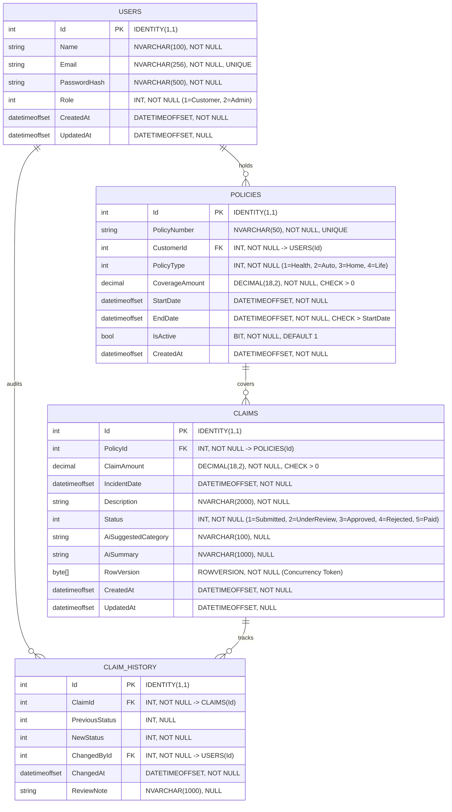
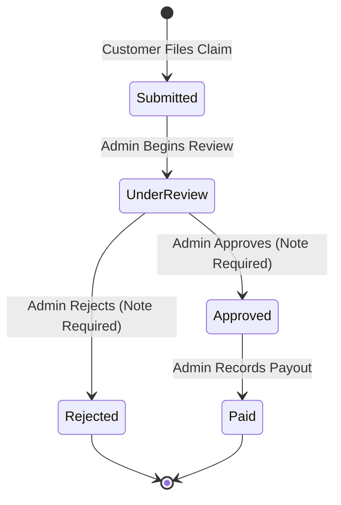

# Database Schema & State Transition Design

## 1. Entity-Relationship Overview

The database design provides strict referential integrity, auditability, and validation constraints implemented both at the application level and enforced at the database level via SQL constraints and indexes.



---

## 2. Table Specifications & Constraints

### 2.1 Table: `Users`
Stores authentication credentials and basic profile information.

| Column | Type | Nullable | Description / Constraints |
| :--- | :--- | :--- | :--- |
| `Id` | `INT` | No | Primary Key, `IDENTITY(1,1)` |
| `Name` | `NVARCHAR(100)` | No | User's full name |
| `Email` | `NVARCHAR(256)` | No | Case-insensitive user email, **Unique Index** (`UX_Users_Email`) |
| `PasswordHash` | `NVARCHAR(500)` | No | Salted PBKDF2 hash string |
| `Role` | `INT` | No | Enum: `1 = Customer`, `2 = Admin`. Check constraint `Role IN (1, 2)` |
| `CreatedAt` | `DATETIMEOFFSET` | No | Timestamp of registration (UTC) |
| `UpdatedAt` | `DATETIMEOFFSET` | Yes | Timestamp of last profile update (UTC) |

### 2.2 Table: `Policies`
Stores insurance contracts belonging to registered customers.

| Column | Type | Nullable | Description / Constraints |
| :--- | :--- | :--- | :--- |
| `Id` | `INT` | No | Primary Key, `IDENTITY(1,1)` |
| `PolicyNumber` | `NVARCHAR(50)` | No | Human-readable unique policy code (e.g. `POL-2026-X8F9`). **Unique Index** |
| `CustomerId` | `INT` | No | Foreign Key to `Users(Id)`. **Delete Rule: RESTRICT / NO ACTION** |
| `PolicyType` | `INT` | No | Enum: `1 = Health`, `2 = Auto`, `3 = Home`, `4 = Life` |
| `CoverageAmount`| `DECIMAL(18,2)`| No | Maximum payout value. Check constraint `CoverageAmount > 0` |
| `StartDate` | `DATETIMEOFFSET` | No | Policy coverage effective date |
| `EndDate` | `DATETIMEOFFSET` | No | Policy coverage expiration date. Check constraint `EndDate > StartDate` |
| `IsActive` | `BIT` | No | Administrative active status flag (Default: `1`) |
| `CreatedAt` | `DATETIMEOFFSET` | No | Creation timestamp (UTC) |

- **Foreign Key**: `FK_Policies_Users_CustomerId` (`CustomerId` -> `Users.Id`)
- **Indexes**:
  - `UX_Policies_PolicyNumber` (Unique)
  - `IX_Policies_CustomerId` (Fast lookup of customer policies)

### 2.3 Table: `Claims`
Records individual claims filed by customers against active policies.

| Column | Type | Nullable | Description / Constraints |
| :--- | :--- | :--- | :--- |
| `Id` | `INT` | No | Primary Key, `IDENTITY(1,1)` |
| `PolicyId` | `INT` | No | Foreign Key to `Policies(Id)`. **Delete Rule: RESTRICT** |
| `ClaimAmount` | `DECIMAL(18,2)`| No | Requested payout amount. Check constraint `ClaimAmount > 0` |
| `IncidentDate` | `DATETIMEOFFSET` | No | Incident timestamp |
| `Description` | `NVARCHAR(2000)`| No | Detailed claim narrative |
| `Status` | `INT` | No | Enum: `1=Submitted`, `2=UnderReview`, `3=Approved`, `4=Rejected`, `5=Paid` |
| `AiSuggestedCategory` | `NVARCHAR(100)` | Yes | GenAI advisory categorization tag (e.g., "Water Damage - Minor") |
| `AiSummary` | `NVARCHAR(1000)` | Yes | GenAI advisory executive summary for admin reviewers |
| `RowVersion` | `ROWVERSION` | No | Optimistic concurrency token (prevents double approval/payment) |
| `CreatedAt` | `DATETIMEOFFSET` | No | Submission timestamp (UTC) |
| `UpdatedAt` | `DATETIMEOFFSET` | Yes | Last status update timestamp (UTC) |

- **Foreign Key**: `FK_Claims_Policies_PolicyId` (`PolicyId` -> `Policies.Id`)
- **Indexes**:
  - `IX_Claims_PolicyId` (Index on foreign key for joins)
  - `IX_Claims_Status` (Filtered / indexed for admin triage queue queries)
  - `IX_Claims_CreatedAt` (Sorting by latest submissions)

### 2.4 Table: `ClaimHistory`
Immutable audit ledger of every status transition and administrator review note.

| Column | Type | Nullable | Description / Constraints |
| :--- | :--- | :--- | :--- |
| `Id` | `INT` | No | Primary Key, `IDENTITY(1,1)` |
| `ClaimId` | `INT` | No | Foreign Key to `Claims(Id)`. **Delete Rule: CASCADE** |
| `PreviousStatus`| `INT` | Yes | Prior status (`NULL` on initial submission) |
| `NewStatus` | `INT` | No | New status reached |
| `ChangedById` | `INT` | No | Foreign Key to `Users(Id)` (the user or admin who triggered the change) |
| `ChangedAt` | `DATETIMEOFFSET` | No | Timestamp of status modification (UTC) |
| `ReviewNote` | `NVARCHAR(1000)`| Yes | Mandatory for `Approved` and `Rejected` statuses; optional otherwise |

- **Foreign Keys**:
  - `FK_ClaimHistory_Claims_ClaimId` (`ClaimId` -> `Claims.Id` with `ON DELETE CASCADE`)
  - `FK_ClaimHistory_Users_ChangedById` (`ChangedById` -> `Users.Id` with `ON DELETE NO ACTION`)
- **Indexes**:
  - `IX_ClaimHistory_ClaimId` (Optimized for loading audit history by claim)

---

## 3. Separation of Constraints: Database vs. Business Logic

A key design principle is distinguishing between **single-row database check constraints** and **multi-entity business logic invariants**:

1. **Database Check Constraints (Physical / Row-Level)**:
   - `CoverageAmount > 0`
   - `ClaimAmount > 0`
   - `EndDate > StartDate`
   - `Users.Role IN (1, 2)`
   - `Claims.Status IN (1, 2, 3, 4, 5)`
   - Enforced directly by SQL Server via EF Core table configurations to guarantee data integrity against rogue scripts or raw SQL migrations.

2. **Application / Business Logic Invariants (Logical / Multi-Entity)**:
   - `ClaimAmount <= Policy.CoverageAmount` (requires reading policy record).
   - `Policy.StartDate <= IncidentDate <= Policy.EndDate` (cross-entity validation).
   - `IncidentDate <= DateTimeOffset.UtcNow` (temporal check).
   - State transition rules (e.g. from `UnderReview` to `Approved`).
   - Enforced cleanly in Application services and Domain models, returning RFC 7807 validation errors.

3. **Append-Only Immutability for ClaimHistory**:
   - `ClaimHistory` is strictly append-only through application operations.
   - The application layer exposes no `Update` or `Delete` methods for audit records.
   - Every status transition atomically inserts a new `ClaimHistory` row in the same transaction that updates `Claims.Status`.

---

## 4. Claim Lifecycle & State Machine Rules

Claim statuses can only transition along verified paths. Illegal transitions are rejected with domain exceptions.



### Transition Matrix

| Current Status | Allowed Target Status | Initiator Role | Required Invariants / Preconditions |
| :--- | :--- | :--- | :--- |
| *(None)* | `Submitted` | Customer | `ClaimAmount <= Policy.CoverageAmount`<br>`Policy.StartDate <= IncidentDate <= Policy.EndDate`<br>`IncidentDate <= DateTimeOffset.UtcNow`<br>`Policy.IsActive == true` |
| `Submitted` | `UnderReview` | Admin | Claim exists and is currently in `Submitted` status |
| `UnderReview` | `Approved` | Admin | Review note provided (`ReviewNote.Length >= 5`) |
| `UnderReview` | `Rejected` | Admin | Review note / rejection reason provided (`ReviewNote.Length >= 10`) |
| `Approved` | `Paid` | Admin | Payment reference or confirmation note recorded; claim must be currently `Approved` |

### Concurrency Conflict Handling (`RowVersion`)
- `Claims.RowVersion` is mapped via EF Core `.IsRowVersion()`.
- When an admin attempts to transition a claim or record a payout, EF Core sends the current `RowVersion` in the `WHERE` clause of the SQL `UPDATE`.
- If another admin or concurrent process updated the claim in the interim, EF Core throws a `DbUpdateConcurrencyException`.
- The API's `ExceptionHandlingMiddleware` catches this exception and returns an RFC 7807 `409 Conflict` response with a clear message:
  ```json
  {
    "type": "https://tools.ietf.org/html/rfc7231#section-6.5.8",
    "title": "Concurrency Conflict",
    "status": 409,
    "detail": "This claim has been modified by another administrator. Please refresh the claim details and retry your action."
  }
  ```

---

## 5. Related Documentation Links
- [System Architecture Overview](ARCHITECTURE.md)
- [API Contract & Endpoint Specifications](API_CONTRACT.md)
- [Security Architecture & Deployment Guide](SECURITY_AND_DEPLOYMENT.md)
- [Phased Implementation Plan](IMPLEMENTATION_PLAN.md)
