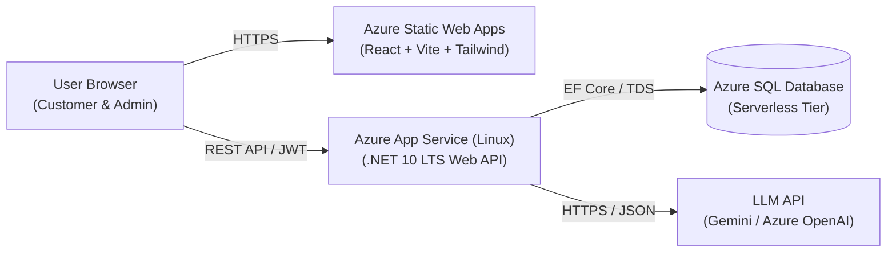

# Security Architecture & Deployment Guide

## 1. Security Architecture & Threat Mitigation

In an insurance and financial transaction application, data confidentiality, data integrity, and strict access control are paramount. The system implements defense-in-depth across the following layers.

---

### 1.1 Authentication & Registration Privilege Escalation Prevention
- **Registration Privilege Escalation Defense**:
  - The public registration endpoint (`POST /api/v1/auth/register`) accepts only `name`, `email`, and `password`.
  - The request DTO intentionally omits any `role` property. If an attacker supplies a `role` field in the raw JSON payload, the model binder ignores it, and the service layer explicitly sets:
    ```csharp
    user.Role = UserRole.Customer;
    ```
  - Administrative accounts cannot be registered via public endpoints. They are created exclusively through secure database seed configurations or authorized administrative management.
- **Password Hashing**:
  - Implemented using `Microsoft.AspNetCore.Identity.PasswordHasher<TUser>`, utilizing **PBKDF2 with HMAC-SHA512** with a 128-bit cryptographically random salt and 100,000+ iterations.
  - Plaintext passwords are never logged, cached, or persisted in memory beyond request execution.
- **JWT (JSON Web Token) Security**:
  - Tokens are signed with HMAC-SHA256 (`HS256`) using a key of at least 256 bits (32 bytes).
  - Configured with explicit `Issuer`, `Audience`, and a reasonable expiration window (e.g., 120 minutes).
  - Claims include `ClaimTypes.NameIdentifier` (user ID), `ClaimTypes.Email`, and `ClaimTypes.Role`.

---

### 1.2 Resource Ownership & BOLA / IDOR Defense
A common vulnerability in web applications is **Broken Object Level Authorization (BOLA)**, also known as **Insecure Direct Object Reference (IDOR)**, where a malicious customer accesses another user's policy or claim simply by altering the ID in the URL: `GET /api/v1/claims/502`.

#### Mitigation Strategy
1. **Controller-level role checks are insufficient**: `[Authorize(Roles = "Customer")]` only verifies that the caller is an authenticated customer.
2. **Context-aware service queries**:
   ```csharp
   public async Task<ClaimDetailsDto> GetClaimByIdAsync(int claimId, int currentUserId, string role)
   {
       var query = _context.Claims
           .Include(c => c.Policy)
           .Include(c => c.History)
           .AsQueryable();

       if (role == UserRoles.Customer)
       {
           // Restrict query strictly to claims whose policy belongs to the logged-in customer
           query = query.Where(c => c.Policy.CustomerId == currentUserId);
       }

       var claim = await query.FirstOrDefaultAsync(c => c.Id == claimId);
       if (claim == null)
       {
           // Return 404 rather than 403 to avoid disclosing the existence of another customer's record
           throw new NotFoundException("Claim", claimId);
       }

       return _mapper.Map<ClaimDetailsDto>(claim);
   }
   ```
3. **Claim Submission Validation**: When a customer files a claim, the backend queries the target policy with `p.Id == dto.PolicyId && p.CustomerId == currentUserId`. If no matching active policy is found, the request is rejected with `404 Not Found`.

---

### 1.3 Concurrency Control & Double-Payout Prevention
In financial operations, two administrators approving or executing a payout simultaneously could trigger duplicate disbursements.

#### Mitigation Strategy
- **Optimistic Concurrency**: The `Claims` entity features a `RowVersion` mapped via EF Core `.IsRowVersion()`.
- If Admin A and Admin B submit state modifications simultaneously, the second transaction fails with a `DbUpdateConcurrencyException`.
- The global `ExceptionHandlingMiddleware` intercepts `DbUpdateConcurrencyException` and maps it to HTTP `409 Conflict`, prompting the administrator to refresh their view.
- Payouts are guarded by atomic status checks:
  ```csharp
  if (claim.Status != ClaimStatus.Approved)
  {
      throw new InvalidClaimStateException("Claim must be in Approved status to record payout.");
  }
  ```

---

### 1.4 AI Safety, Guardrails & Governance (Phase 7 Implementation)
- **Sequence in Roadmap**: GenAI integration is deliberately scheduled after the core claim workflows, status transitions, role authorizations, and baseline integration test suites are fully verified.
- **Strictly Advisory**: AI suggestions are returned ephemerally to the requesting administrator (`POST /api/v1/admin/claims/{id}/advisory`). The LLM cannot execute state changes, approve claims, calculate disbursements, or modify database records.
- **Data Minimization & Privacy Protection**: Prompts sent to the LLM contain only the minimum necessary business context: policy type name, claim amount, incident date, and claim description. All Personally Identifiable Information (PII)—including customer names, customer IDs, emails, password hashes, policy numbers, bank account numbers, JWT bearer tokens, and payment references—is strictly excluded from prompt construction.
- **Prompt Injection Defense**: Claim descriptions provided by customers are treated strictly as untrusted user input, isolated inside explicit boundary tags (`<claim_description>...</claim_description>`). System instructions explicitly order the model never to treat text inside boundary tags as instructions or commands.
- **Structured Output & Schema Enforcement**: Gemini REST API structured output mode is utilized (`response_mime_type: "application/json"` with JSON schema) enforcing `category`, `summary`, and `suggestedPriority`.
- **Independent Server-Side Validation**: All LLM output undergoes secondary server-side sanitization: markdown code fences are stripped, categories are validated against allowed enums (`Medical`, `AutoAccident`, `PropertyDamage`, `WaterDamage`, `Theft`, `Life`, `Other`), priorities are validated (`Low`, `Medium`, `High`), and summary string lengths are bounded to a maximum of 1,000 characters.
- **Resilience & Safe Fallback**: The client features configurable timeouts (15s), linked cancellation tokens, and exponential backoff retry policies for transient failures (HTTP 429 and 5xx). If the provider is unconfigured, unreachable, or persistently failing, the API returns standard RFC 7807 `503 Service Unavailable`. The core application workflows remain 100% operational, and artificial fallback values are never disguised as real model evaluations.
- **Zero Automated Test Costs**: All automated unit and integration tests utilize test doubles (`TestLlmClient`, `MockIntegrationLlmClient`), preventing accidental charges, external network calls, or non-deterministic test results in CI/CD pipelines.

---

### 1.5 Security Regression Testing & Sanitization
The system includes comprehensive automated security regression suites in `InsuranceClaimsTracker.IntegrationTests/SecurityRegressionTests.cs` and `ClaimAdvisoryEndpointTests.cs`:

- **Authentication Regression Tests**:
  - Missing JWT token returns `401 Unauthorized`.
  - Malformed JWT tokens return `401 Unauthorized`.
  - Expired JWT tokens return `401 Unauthorized`.
  - Invalid JWT signatures (tampered or signed with unauthorized keys) return `401 Unauthorized`.
- **Authorization Regression Tests**:
  - Customers cannot create policies (`POST /api/v1/policies` returns `403 Forbidden`).
  - Customers cannot start claim reviews (`POST /api/v1/admin/claims/{id}/start-review` returns `403 Forbidden`).
  - Customers cannot make approval/rejection decisions (`POST /api/v1/admin/claims/{id}/decision` returns `403 Forbidden`).
  - Customers cannot disburse payouts (`POST /api/v1/admin/claims/{id}/payout` returns `403 Forbidden`).
  - Customers cannot invoke claim advisory triage (`POST /api/v1/admin/claims/{id}/advisory` returns `403 Forbidden`).
  - Public registration attempts with injected `role: "Admin"` parameters are neutralized (assigned `UserRole.Customer`).
- **BOLA / IDOR Defense Tests**:
  - Customer A cannot retrieve Customer B's policy (`GET /api/v1/policies/{id}` returns `404 Not Found`).
  - Customer A cannot retrieve Customer B's claim (`GET /api/v1/claims/{id}` returns `404 Not Found`).
  - Customer A cannot file a claim against Customer B's policy (`POST /api/v1/claims` returns `404 Not Found`).
  - Queries for policies and claims strictly scope returned entities to the authenticated caller's customer ID.
- **Information Disclosure Sanitization**:
  - Security, validation, and AI provider errors return standardized RFC 7807 `ProblemDetails` payloads.
  - Production responses never expose internal stack traces, database schema specifics, SQL Server connection strings, or JWT signing secrets.
  - Unexpected internal errors return generic client-safe messages: `"An unexpected error occurred while processing your request. Please try again later."`

---

## 2. Secrets Management & Environment Configuration

Secrets must never be committed to source control.

| Environment | Secret Storage Mechanism | Configuration Source |
| :--- | :--- | :--- |
| **Local Development** | `dotnet user-secrets` | `secrets.json` mapped to `appsettings.Development.json` |
| **CI / Automated Tests** | GitHub Actions / Pipeline Secrets | Environment variables injected into test runners |
| **Azure Production** | Azure Key Vault / App Service App Settings | Environment variables (`WEBSITE_RUN_FROM_PACKAGE`) |

### Critical Configuration Keys

```bash
# Database Connection
ConnectionStrings__DefaultConnection="Server=(localdb)\\mssqllocaldb;Database=InsuranceClaimsTrackerDb;Trusted_Connection=True;MultipleActiveResultSets=true"

# JWT Security
JwtSettings__Secret="<At-least-32-characters-cryptographic-random-key>"
JwtSettings__Issuer="InsuranceClaimsTrackerApi"
JwtSettings__Audience="InsuranceClaimsTrackerClient"
JwtSettings__DurationInMinutes="120"

# AI Integration (Phase 7: Google Gemini REST Client)
# Note: ApiKey is passed via x-goog-api-key HTTP header (never query parameters or URL logs)
AiService__Provider="Gemini"
AiService__ModelId="gemini-2.5-flash"
AiService__BaseUrl="https://generativelanguage.googleapis.com/v1beta"
AiService__ApiKey="<LLM-API-KEY-STORED-IN-USER-SECRETS>"
AiService__TimeoutSeconds="15"
AiService__MaxRetries="3"
```

---

## 3. Deployment Architecture



### Azure Deployment Prerequisites
1. **Azure Resource Group**: Logical container (e.g. `rg-insurance-tracker-prod`).
2. **Azure SQL Database**: Serverless tier with firewall allowing Azure services.
3. **Azure App Service**: Linux container running .NET 10 LTS runtime.
4. **Azure Static Web Apps**: Connects to the GitHub repository's `frontend/` directory for automated CI/CD deployment.
5. **CORS Policy**: Configured on the API to allow only the Static Web App domain.

---

## 4. Related Documentation Links
- [System Architecture Overview](ARCHITECTURE.md)
- [Database Schema & State Transitions](DATABASE_SCHEMA.md)
- [API Contract & Endpoint Specifications](API_CONTRACT.md)
- [Phased Implementation Plan](IMPLEMENTATION_PLAN.md)
